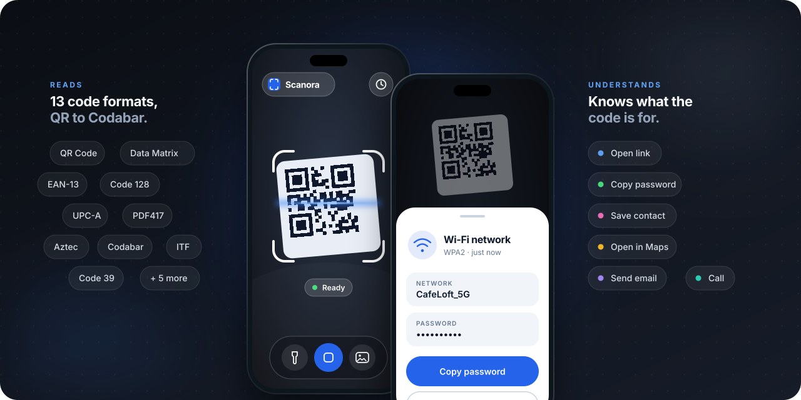
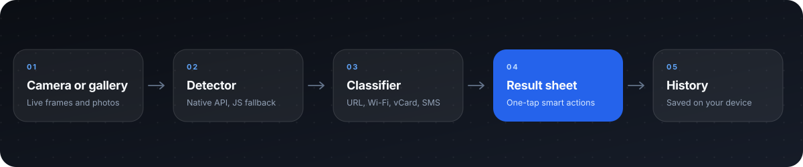

<div align="center">


<h1>Scanora</h1>

<p><b>Point. Scan. Done.</b><br/>
A QR and barcode scanner that opens instantly, works offline, and keeps everything on your phone.</p>

<p>
<a href="../../releases/latest"><b>Download APK</b></a> &nbsp;·&nbsp;
<a href="#try-it-in-your-browser">Try in browser</a> &nbsp;·&nbsp;
<a href="#build-it-yourself">Build it</a> &nbsp;·&nbsp;
<a href="../../issues">Report a bug</a>
</p>

<p>


</p>

</div>

<br/>

<p align="center">
  
</p>

<br/>

## The idea

Most scanner apps ask for too much and show you too much. Scanora doesn't.

You open it and the camera is already running. Point it at a code and it reads it, works out what it is, and puts the right button in front of you. A link gets **Open**. A Wi-Fi code gets **Copy password**. A contact card gets **Save contact**. That's the whole app.

No sign-up, no ads, no server. It doesn't even need internet.

<br/>

## What you get

<table>
<tr>
<td width="33%" valign="top">

### Instant
No splash screen, no menus to dig through. The scanner is the first thing you see, and a code is usually read before you've finished lifting the phone.

</td>
<td width="33%" valign="top">

### Smart
Scanora recognises what's inside the code and offers actions that fit, instead of dumping raw text on you.

</td>
<td width="33%" valign="top">

### Private
Everything is stored on your device. Nothing is uploaded, synced or tracked. Share only happens when you press Share.

</td>
</tr>
<tr>
<td width="33%" valign="top">

### Comfortable in the dark
Flashlight, pinch to zoom and tap to focus are all built into the viewfinder, so scanning a code on a dim shelf isn't a struggle.

</td>
<td width="33%" valign="top">

### Gallery friendly
Got a screenshot or a photo of a code? Pick it from your gallery and Scanora reads it like any other scan.

</td>
<td width="33%" valign="top">

### Easy on the eyes
A calm, glassy interface with light and dark themes that follow your phone, and small animations that feel natural.

</td>
</tr>
</table>

<br/>

## Scan it, then do something with it

| When the code contains | Scanora gives you |
| :-- | :-- |
| A website | **Open link**, Copy |
| A Wi-Fi network | **Copy password**, Copy network name |
| A contact card | **Save contact**, Copy phone number |
| A text message | **Send message**, Copy |
| A location | **Open in Maps**, Copy coordinates |
| An email address | **Send email**, Copy |
| A phone number | **Call**, Copy |
| Anything else | **Copy**, Share |

Links are checked before they're opened, so only proper `http` and `https` addresses go through.

<br/>

## Every code, not just QR

| 2D | 1D |
| :-- | :-- |
| QR Code | EAN-13 · EAN-8 |
| Data Matrix | UPC-A · UPC-E |
| PDF417 | Code 128 · Code 39 · Code 93 |
| Aztec | ITF · Codabar |

Scanora uses the device's built-in `BarcodeDetector` when it's available. If it isn't, a small pure-JavaScript decoder takes over for common retail barcodes, still with no network involved.

<br/>

## Your history, tidy

Every scan is saved automatically, and you stay in control of it.

- **Search** by content, format or date
- **Filter** to QR codes or barcodes, and **sort** by newest, oldest or type
- **Swipe** a card to delete it
- **Export** everything to a `.txt` file
- **Clear all** in one tap, with a confirmation first
- **Mute** the scan sound whenever you like

<br/>

> [!NOTE]
> **Privacy isn't a setting here, it's how the app is built.** Scans live in your device's IndexedDB (with a localStorage fallback). The camera is only used for scanning, and Scanora explains why before it asks for permission.

<br/>

## Install

**On Android**

1. Open the [Releases](../../releases/latest) page
2. Download `release.apk`
3. Open the file and allow installs from your browser if Android asks

Every push to `main` builds a fresh APK and publishes it as a new release automatically.

### Try it in your browser

Scanora is one static page, so any local server works. The camera is allowed on `localhost`.

```bash
git clone https://github.com/akhil-rashed/scanora.git
cd scanora
npx serve www
```

<br/>

## Build it yourself

You'll need **Node.js 20+**, **JDK 21** and **Android Studio** (or the Android SDK).

```bash
npm install                # Capacitor and its CLI
npx cap add android        # create the native Android project
npx cap sync android       # copy www/ into it
npx cap open android       # open in Android Studio, then press Run
```

Add camera access to `android/app/src/main/AndroidManifest.xml` if it's missing:

```xml
<uses-permission android:name="android.permission.CAMERA" />
<uses-feature android:name="android.hardware.camera" android:required="false" />
```

<br/>

## How it works

<p align="center">
  
</p>

The whole app is a single HTML file with no framework and no runtime dependencies. Hardware access (camera, torch, gallery, file export) goes through a small `NativeBridge` layer, which is why the same code runs as a web page, as a Capacitor app, or inside a plain Android WebView.

<details>
<summary><b>Project structure</b></summary>

<br/>

```
scanora/
├── www/
│   └── index.html            the app: UI, styles and logic
├── index.html                source copy of the app
├── docs/                     images used in this README
├── capacitor.config.json     app id, name and web directory
├── package.json              Capacitor dependencies
└── .github/workflows/
    └── build.yml             builds, signs and releases the APK
```

</details>

<details>
<summary><b>Tech stack</b></summary>

<br/>

| | |
| :-- | :-- |
| App | HTML, CSS and vanilla JavaScript |
| Native shell | [Capacitor](https://capacitorjs.com) 7 |
| Detection | `BarcodeDetector` API with a JS fallback |
| Storage | IndexedDB |
| CI/CD | GitHub Actions, signed APK and GitHub Releases |

</details>

<br/>

## What's next

- [ ] Create QR codes inside the app
- [ ] Scan several codes in one session
- [ ] Export history as CSV
- [ ] Installable web version (PWA)
- [ ] More languages

Got an idea that isn't on the list? [Open an issue](../../issues) and let's talk about it.

<br/>

## Contributing

Pull requests are welcome, big or small.

1. Fork the repo and create a branch: `git checkout -b my-idea`
2. Make your change and test it on a real phone if you can
3. Open a pull request and tell me what it does

<br/>

<div align="center">

Built by [Akhil Rashed](https://github.com/akhil-rashed)

If Scanora saved you a few seconds, a ⭐ on the repo is a lovely thank-you.

</div>
